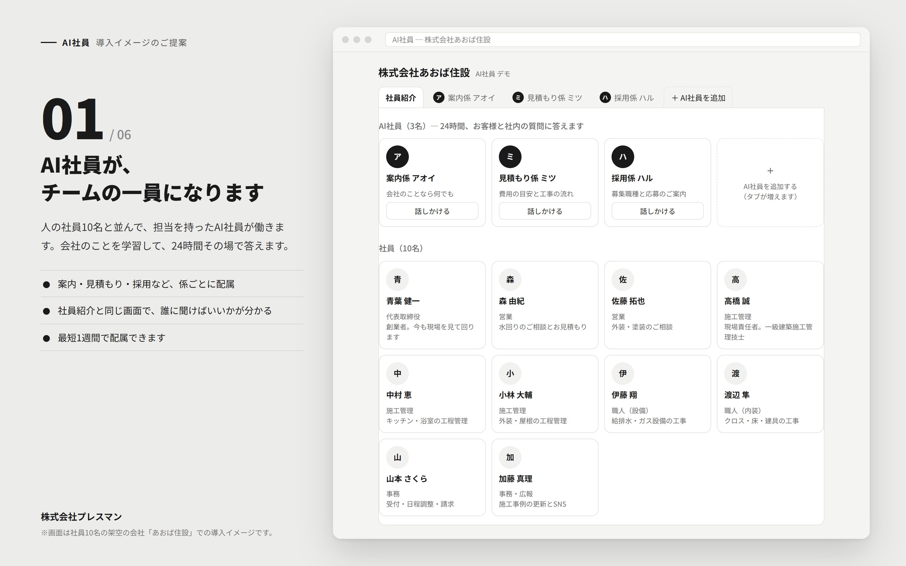
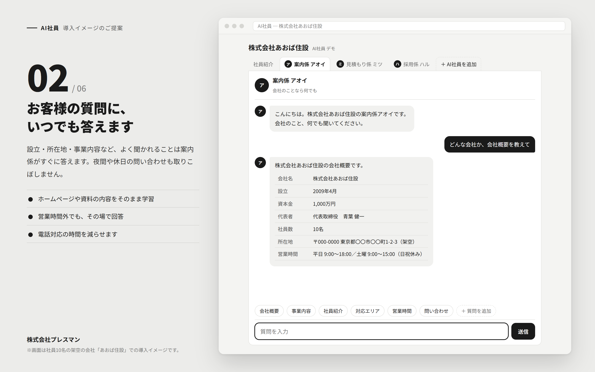
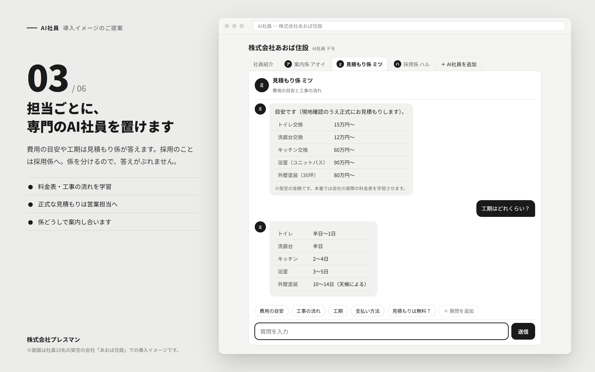
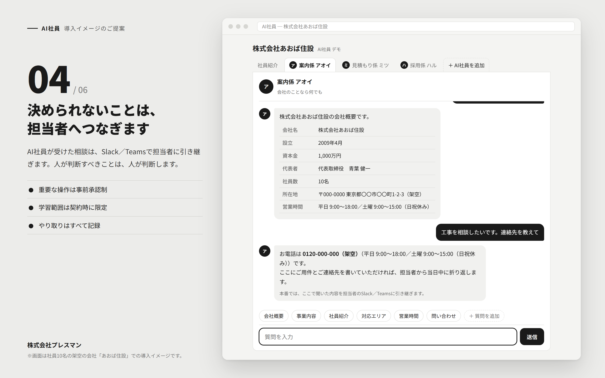
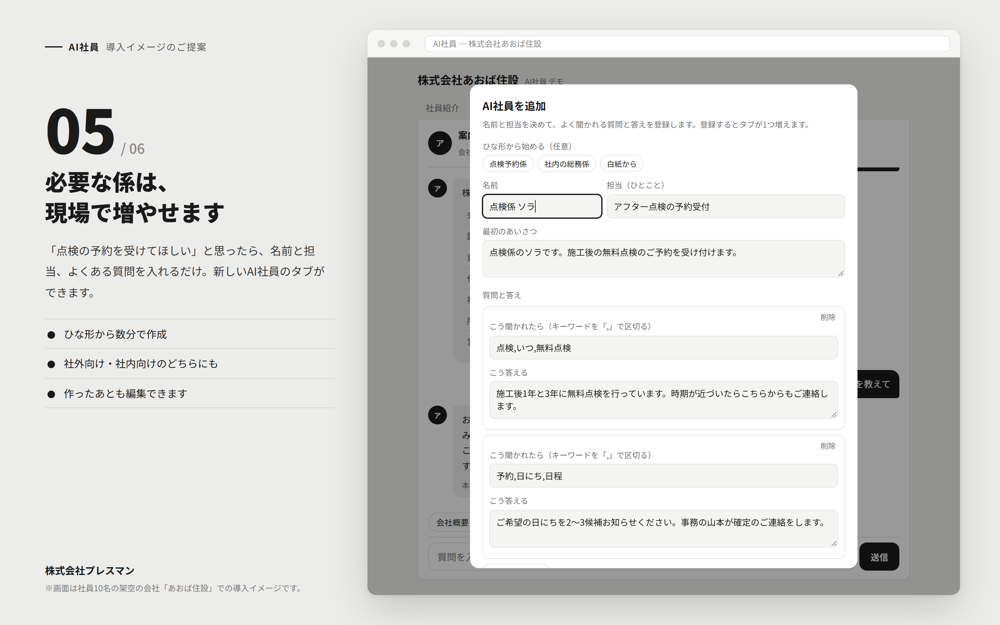
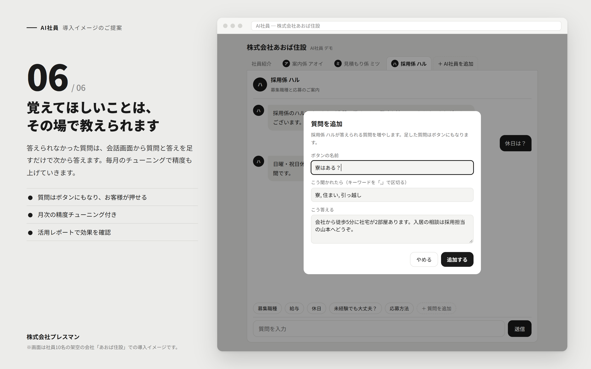

# AI社員 デモ

株式会社プレスマンの「[AI社員](https://www.pressman.ne.jp/ai-employee/02)」を、お客様向けにどう使うかを見せるプロトタイプです。
HTML 1枚で動きます（AIは未接続、キーワードで答えを選ぶ簡易版）。

## 触ってみる

- デモ（社員10名の架空の会社「あおば住設」）: https://tsubasagit.github.io/ai-employee-demo/
- プレスマン自社版（公式サイトの会社概要を答える）: https://tsubasagit.github.io/ai-employee-demo/pressman.html

## できること

- **社員紹介**：AI社員と人の社員10名を一覧で見る
- **AI社員ごとのタブ**：案内係・見積もり係・採用係が、それぞれの担当の質問に答える
- **＋ AI社員を追加**：名前・担当・質問と答えを入れると、新しいタブができる（ひな形あり）
- **＋ 質問を追加**：会話画面から、そのAI社員が答えられる質問をその場で増やす

追加したAI社員・質問は、開いたブラウザの中にだけ保存されます。

## 提案用スクリーンショット

`screenshots/` に6枚（3200×2000px）。

| | |
|---|---|
|  |  |
|  |  |
|  |  |

撮り直すときは `npm i puppeteer-core` のあと `node tools/shoot.mjs`。

## 注意

- 「あおば住設」の会社名・人物・住所・金額はすべて架空です。
- プレスマン自社版の内容は、公式サイトの会社概要ページ（2026年10月時点）をもとにしています。

制作：株式会社AppTalentHub
